# Microservices-based e-commerce

E-commerce with an Angular frontend, Spring Boot backend, Spring Cloud, OIDC identity through Keycloak, synchronous and asynchronous communication, and observability.

The main flow includes atomic inventory operations, order cancellation, Outbox, DLQ, and order owner authorization. The gateway provides browser login as a BFF and API access with Bearer tokens.

Live demo: https://loja.fabianoquirinos.com.br

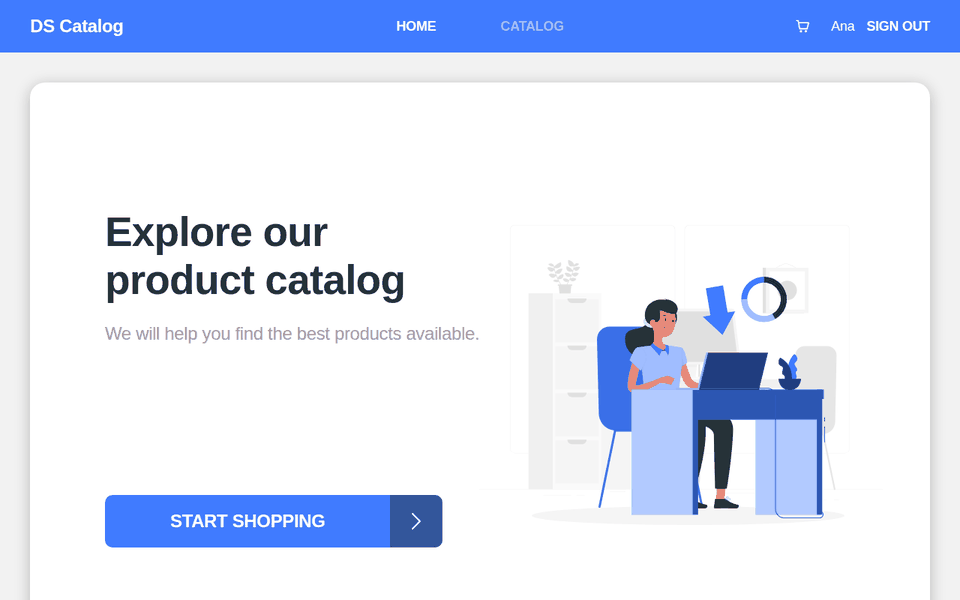

## Screenshots

| Catalog | Product detail |
|---|---|
| 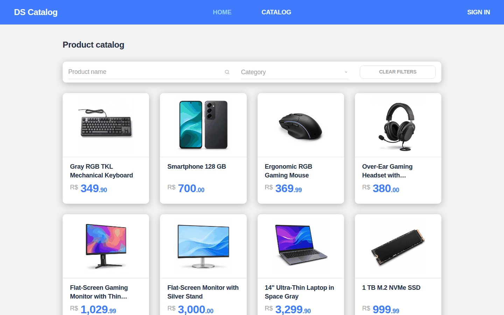 | 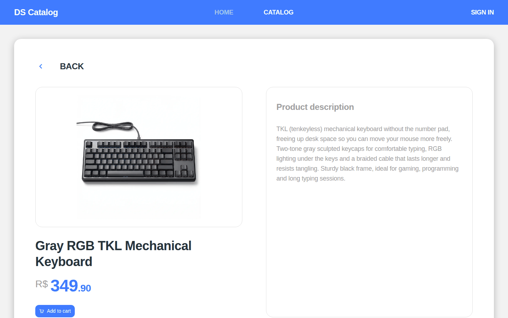 |
| **Cart** | **Checkout** |
| 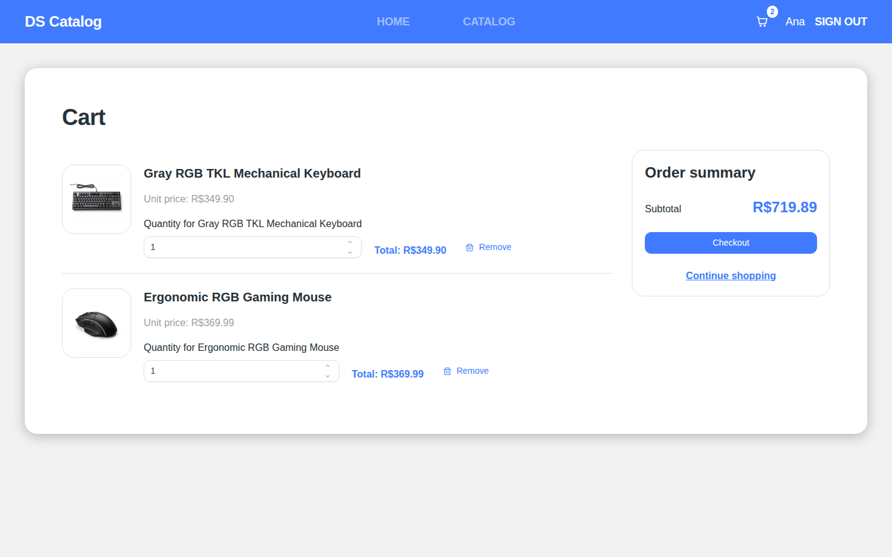 | 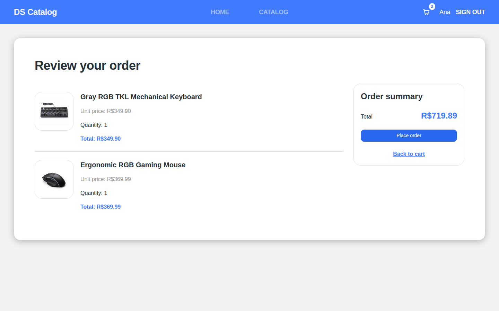 |
| **Order confirmation** | **Login (custom Keycloak theme)** |
| 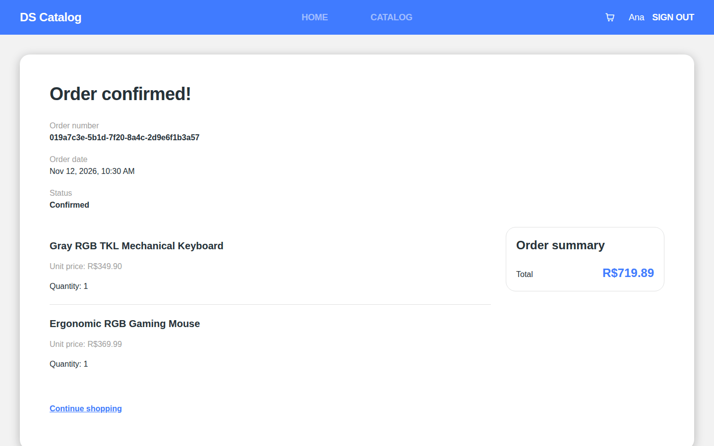 | 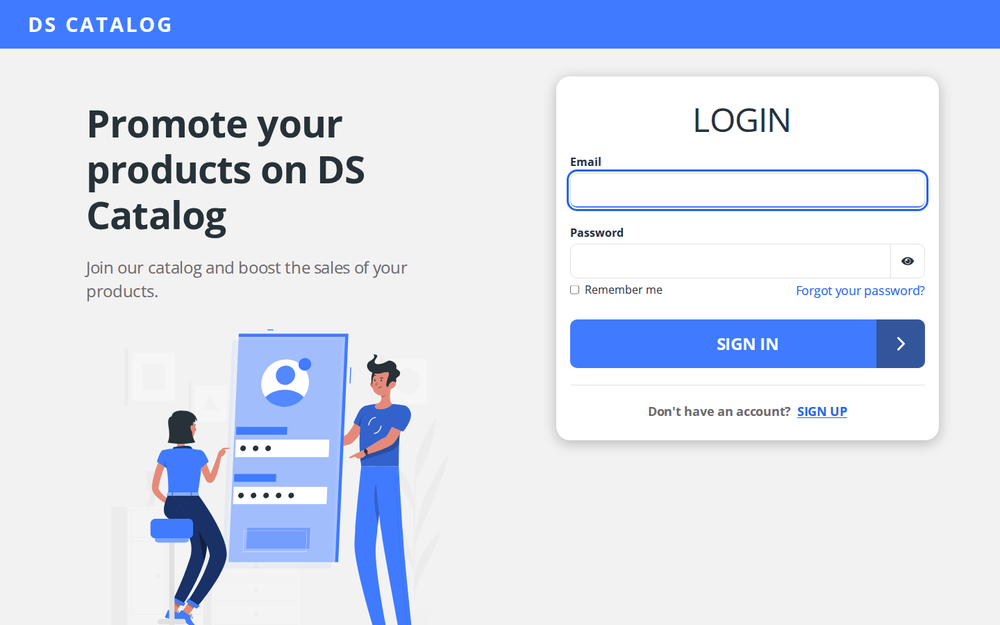 |
| **Admin: products** | **Admin: product form with stock** |
| 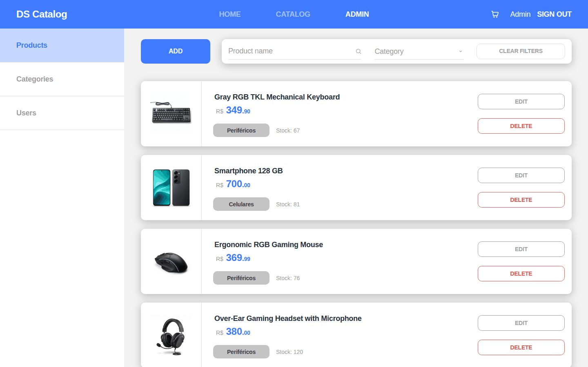 | 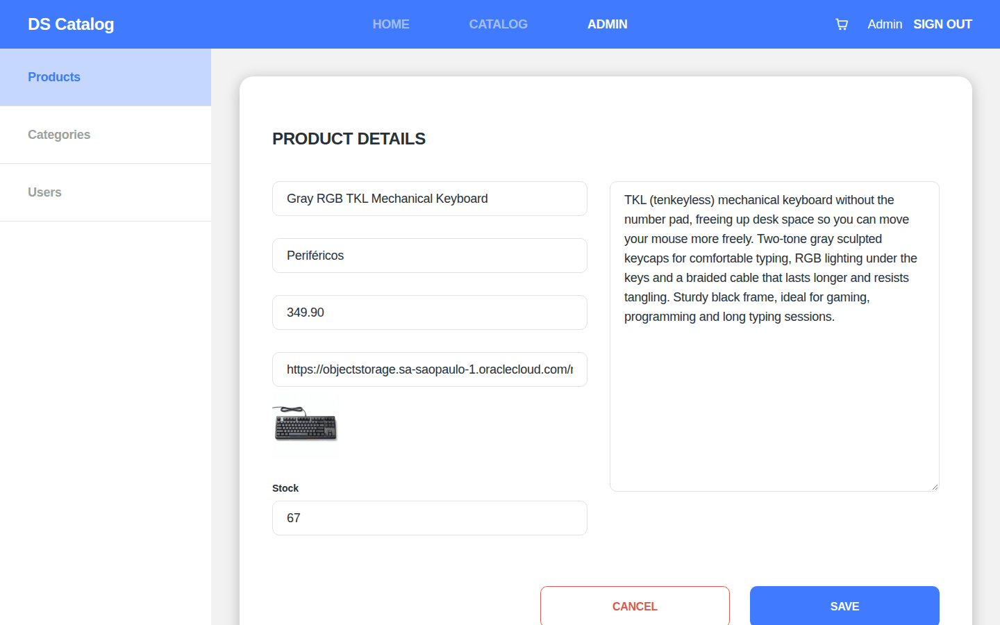 |
| **Order confirmation email (SMTP via OCI Email Delivery)** | **Dark mode** |
| 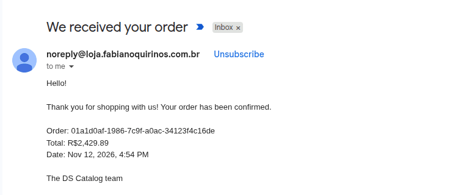 | 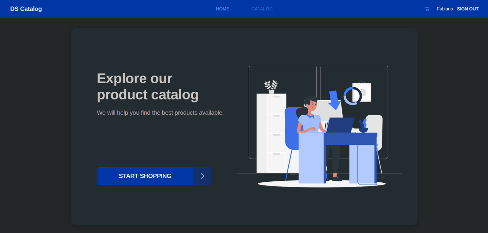 |

<p align="center"></p>

## Current architecture

| Component | Container port | Persistence | Responsibility |
|---|---:|---|---|
| Angular Frontend | 8080 (host `127.0.0.1:8008`) | — | SPA, catalog, cart, and orders; unprivileged nginx |
| API Gateway | 8080; management 8090 | Redis | OIDC BFF, session, token relay, and edge authorization |
| Product Service | 8082 | MongoDB | Product catalog and CRUD |
| Inventory Service | 8083 | PostgreSQL | Inventory queries, maintenance, and atomic reservations |
| Order Service | 8081 | PostgreSQL | Orders, cancellation, compensation, and Outbox |
| Notification Service | 8084 | Redis | Idempotent event consumption, retry, and DLQ; order emails over SMTP |
| Keycloak | 8080; management 9000 | PostgreSQL | Identity, registration, login, password recovery, and token issuance |

The frontend is the sixth deployed app. The five Java applications are Gateway, Product, Inventory, Order, and Notification; the sixth module is the `common-security` library. Business services validate token signatures, issuer, and audience locally. Orders use the Keycloak `sub` as the owner identity, and user roles are `CUSTOMER` and `ADMIN`.

```text
Browser -> edge nginx -> Angular Frontend
                          `-> Gateway BFF <-> Keycloak -> PostgreSQL
                                      `-> Redis (sessions)
Bearer client -> Gateway
                    |-> Product -> MongoDB
                    |-> Inventory -> PostgreSQL
                    `-> Order -> PostgreSQL (order + Outbox)
                          |-> Product/Inventory via OpenFeign
                          `-> RabbitMQ -> Notification -> Redis (idempotency)
                                       `-> Inventory -> PostgreSQL (idempotent release on cancellation)

Compose network: service resolution through DNS
Prometheus/Grafana: metrics; Zipkin: traces
```

## Technologies

- Java 21, Spring Boot 4.0.x, and Spring Cloud 2025.1.x
- Spring MVC, Data JPA, Data MongoDB, and Flyway
- Spring Cloud Gateway Server Web MVC and OpenFeign
- Spring Security OAuth2/OIDC Resource Server and Client; Authorization Code with PKCE
- PostgreSQL, MongoDB, RabbitMQ, and Redis
- Docker Compose, Actuator, Prometheus, Grafana, Zipkin, and Springdoc OpenAPI

## Endpoints

External application requests go through `http://localhost:8080`. In Compose, the ports for Product, Inventory, Order, Notification, and the gateway Actuator are not published on the host.

### Browser login

| Method | Gateway route | Description |
|---|---|---|
| GET | `/oauth2/authorization/keycloak` | Starts Authorization Code with PKCE in Keycloak |
| GET | `/login/oauth2/code/keycloak` | Gateway OIDC callback |
| GET | `/bff/me` | Session-authenticated user details |
| POST | `/logout` | Ends the session and starts OIDC logout |

The BFF keeps tokens on the server and stores sessions in Redis. State-changing requests with session authentication, including logout, require CSRF protection (`XSRF-TOKEN` and the `X-XSRF-TOKEN` header). Bearer token access is stateless. Registration and password recovery take place in Keycloak according to the realm configuration.

### Business API

| Method | Route | Access |
|---|---|---|
| GET | `/api/product`, `/api/product/{id}` | Public |
| POST | `/api/product` | `ROLE_ADMIN` |
| PUT, DELETE | `/api/product/{id}` | `ROLE_ADMIN` |
| GET | `/api/inventory?skuCode=id` | Public |
| POST | `/api/inventory` | `ROLE_ADMIN` |
| PUT | `/api/inventory/{skuCode}` | `ROLE_ADMIN` |
| GET | `/api/order` | Authenticated; users see their own orders, admins see all orders |
| GET | `/api/order/{id}` | Owner or admin |
| POST | `/api/order` | Authenticated |
| POST | `/api/order/{id}/cancel` | Owner or admin; idempotent cancellation of a confirmed order |

`PUT`, `DELETE`, and `GET /api/inventory/reservations/{reservationId}` are internal reservation ledger contracts, blocked at the gateway (`denyAll`). During order creation and reconciliation of expired pending orders, Order obtains a token using `client_credentials` with the `inventory:reserve` scope to call them directly on Inventory. Cancelling a confirmed order writes the `ORDER_CANCELLED` (v3) event to the Outbox, and Inventory releases stock asynchronously and idempotently through RabbitMQ (`inventory.order.cancelled.queue`).

## Local execution

### Prerequisites

- Docker with Docker Compose v2; Java 21 to run through the IDE or Maven Wrapper
- OpenSSL to generate local secrets
- Ports `3000`, `5432`, `5672`, `6379`, `8025`, `8080`, `8180`, `9090`, `9411`, `15672`, and `27017` available

### Building with Maven

Import the root `pom.xml` as a Maven project with JDK 21. The parent aggregates the five services and the `common-security` JAR, which handles only Keycloak authority conversion. There is a single Maven Wrapper at the root (Maven 3.9.12); on Windows, use `mvnw.cmd`.

Run from the root:

```bash
# Builds and verifies all modules
./mvnw verify

# Verifies one service and the modules it depends on
./mvnw -pl order-service -am verify

# Runs only the shared converter tests
./mvnw -pl common-security test
```

Integration tests using Testcontainers require access to Docker. The first wrapper run and dependency resolution require access to Maven Central. Compose uses the root as the build context and each service's Dockerfile; the final image contains only the Java runtime and curl, which is required for health checks.

### Compose files and profiles

The root Compose configuration is the official entry point for all infrastructure.

| File | Contents |
|---|---|
| `docker-compose.yml` | Production: applications, Keycloak, RabbitMQ, Redis, and monitoring; external databases on OCI |
| `docker-compose.dev.yml` | Local override: PostgreSQL, MongoDB, Mailpit, and network/configuration adjustments for development |

| Profile | Services |
|---|---|
| _(none)_ | `keycloak`, `keycloak-config`, `rabbitmq`, `rabbitmq-init`, `redis`; in development, also `postgres`, `mongo`, `mailpit` |
| `monitoring` | `zipkin`, `prometheus`, `grafana` |
| `apps` | `api-gateway`, `product-service`, `inventory-service`, `order-service`, `notification-service` |

The root `.env.example` is the official reference and sets `COMPOSE_PROFILES=monitoring,apps`. Addresses and secrets are configurable per environment; required variables use `${VAR:?}` so Compose rejects incomplete configuration.

### Environment configuration

From the repository root:

```bash
./scripts/generate-env.sh
```

The script creates `.env` from the example: it replaces values marked with `troque-politica-...` (Keycloak realm user passwords, such as `KC_ADMIN_USER_PASSWORD`) with a 24-character password that meets the realm policy (uppercase, lowercase, digit, and a special character from `-_.`), and **each** other `troque-...` value with an independent 24-byte secret generated by `openssl rand -hex 24`. It does not print secrets and creates the file with permissions `600`. It refuses to overwrite an existing `.env`; `./scripts/generate-env.sh --force` creates a backup with permissions `600` before replacement. `.env` and its backups contain credentials and must not be shared or committed to version control.

In development, Order and Inventory use the `postgres` user in the local container: the effective password is `DB_PASSWORD`. The example sets `ORDER_DB_PASSWORD=${DB_PASSWORD}` and `INVENTORY_DB_PASSWORD=${DB_PASSWORD}`, references expanded by Compose. In production, configure separate users and passwords for each database and generate the variables through OCI Vault. The Keycloak database has a separate user and password.

Service addresses are environment configuration: the gateway uses `PRODUCT_SERVICE_URL`, `ORDER_SERVICE_URL`, and `INVENTORY_SERVICE_URL`; Order uses only `PRODUCT_SERVICE_URL` and `INVENTORY_SERVICE_URL`. In Compose, these variables point to `http://product-service:8082`, `http://order-service:8081`, and `http://inventory-service:8083`, resolved by DNS on the container network. Each consumer waits for its dependencies' health checks. In the IDE, the defaults are `http://localhost:8082`, `http://localhost:8081`, and `http://localhost:8083`. The platform handles name resolution: Docker Compose today, Kubernetes Services in the future.

### Keycloak realm

The `ecommerce` realm is managed as code: [`keycloak/realm-ecommerce.yaml`](keycloak/realm-ecommerce.yaml). On every Compose startup, the one-shot `keycloak-config` service ([keycloak-config-cli](https://github.com/adorsys/keycloak-config-cli)) waits for Keycloak to become healthy and reconciles the realm with the file; applications that validate tokens start only after it exits with code `0`. The import cache is disabled, so any setting declared in the file that is manually changed in the console reverts to the file's value on the next startup: change the realm through the file in a PR. The tool only removes resources it created; a client or role created manually outside the file continues to exist and must be removed manually.

Secrets, the public URL, and SMTP settings are supplied through environment variables (`KC_BFF_CLIENT_SECRET`, `KC_ORDER_SERVICE_CLIENT_SECRET`, `GATEWAY_PUBLIC_URL`, `KC_SMTP_*`), substituted when the configuration is applied; the same value from `.env`/Vault reaches Keycloak and the service that uses the client. These values must use only safe characters (`A–Z`, `a–z`, `0–9`, `_`, `.`, `~`, and `-`), such as those generated by `scripts/generate-env.sh`. The file does not define users: customers register through the Keycloak page and receive only the `CUSTOMER` role; `ADMIN` is assigned manually.

| Client | Configuration |
|---|---|
| `ecommerce-bff` | Confidential; Authorization Code with PKCE S256; exact redirect `${GATEWAY_PUBLIC_URL}/login/oauth2/code/keycloak`; no Password Grant, Implicit, device flow, or `offline_access`; tokens contain only the `CUSTOMER`/`ADMIN` roles, also included in the ID token (read by `/bff/me`) |
| `order-service` | Confidential; service account only (`client_credentials`); `inventory:reserve` scope; no user roles in the token |

The realm requires HTTPS outside the local network, email verification, strong passwords with history, progressive brute-force protection, 5-minute access tokens, and sessions limited to 30 minutes idle or 10 hours total. It records login and administrative events (without request bodies, which would include secrets). Access tokens carry `aud=ecommerce-api`. In the local environment, the public issuer is `http://localhost:8180/realms/ecommerce`; containers access JWKs and the token endpoint through the internal network. The `OIDC_*` variables control these addresses. In development, SMTP points to Mailpit (`http://localhost:8025`).

Google and GitHub login is optional and disabled by default. To enable it, create an OAuth client with the provider using the callback URL `${KEYCLOAK_HOSTNAME}/realms/ecommerce/broker/<google|github>/endpoint` and set `KC_IDP_<GOOGLE|GITHUB>_ENABLED=true`, `_CLIENT_ID`, and `_CLIENT_SECRET` in `.env`. Provider accounts are never linked automatically by email: if the email already exists, Keycloak asks the user to confirm the link by signing in with the existing account. Google email is trusted (already verified by Google); GitHub email goes through the realm's email verification.

With email verification enabled, the registration form asks only for profile details; the password is set after clicking the verification link. This prevents someone from creating an account with another person's email and a password of their own before the email owner does.

For production with HTTPS, see [Deploy on OCI](#deploy-na-oci). The development override uses `SESSION_COOKIE_SECURE=false` for local HTTP.

### Startup

For production, follow [Deploy on OCI](#deploy-na-oci). For local development:

```bash
# Local development: infrastructure and applications
docker compose -f docker-compose.yml -f docker-compose.dev.yml up -d --build
```

`rabbitmq-init` is a one-shot service: after the broker becomes healthy, `scripts/rabbitmq-init.sh` uses the HTTP API to provision the `ecommerce` vhost and the `order-service`, `notification-service`, and `inventory-service` users. This container normally exits with code `0`; it is not a long-running process.

The applications use `RABBITMQ_ORDER_PASSWORD`, `RABBITMQ_NOTIFICATION_PASSWORD`, and `RABBITMQ_INVENTORY_PASSWORD` in the `ecommerce` vhost with least privilege: `order-service` (the sole topology owner and producer) has `configure`, `write`, and `read` on `^(order|inventory)\.`, `notification-service` (consumer) has `configure` and `write` on `^$` and `read` only on `^order\.(created|cancelled)\.queue$`, and `inventory-service` (cancellation consumer) has `configure` and `write` on `^$` and `read` only on `^inventory\.order\.cancelled\.queue$`. `RABBITMQ_ADMIN_USERNAME`/`RABBITMQ_ADMIN_PASSWORD` are administrative credentials for the console and provisioning, not for the microservices. AMQP (`5672`) is published only in the local override, on loopback.

### Demo data (development only)

The development override includes three one-shot services: `seed-products` (20 products in MongoDB), `seed-inventory` (stock for those products in PostgreSQL, with one out-of-stock item and one low-stock item), and `seed-keycloak-admin` (store `ADMIN` user in the Keycloak `ecommerce` realm). The scripts are in [`scripts/dev/seed/`](scripts/dev/seed/) and are mounted **only** by `docker-compose.dev.yml`: production Compose does not reference them, and `.dockerignore` keeps them out of the images.

Products have fixed `_id` values because inventory uses the product ID as `sku_code`. Seeding is idempotent and non-destructive: it runs on every startup, inserts only missing records, and never overwrites products or quantities changed through the API. `product-service` and `order-service` wait for seeding to finish. `seed-inventory` waits for the table created by Inventory Service's Flyway migrations, so it also works with the service running through the IDE. To reload without recreating volumes:

```bash
docker compose -f docker-compose.yml -f docker-compose.dev.yml up seed-products seed-inventory
```

`seed-keycloak-admin` waits for `keycloak-config` to finish and uses `kcadm.sh` to create the store's `ADMIN` user (if it does not already exist) in the `ecommerce` realm from `KC_ADMIN_USER_EMAIL` and `KC_ADMIN_USER_PASSWORD`. The user is enabled, has `emailVerified=true`, has no pending actions, and is assigned the `ADMIN` role. The password is always reapplied, so changing `KC_ADMIN_USER_PASSWORD` in `.env` and running the seed again rotates the password:

```bash
docker compose -f docker-compose.yml -f docker-compose.dev.yml up seed-keycloak-admin
```

Useful services (published on `127.0.0.1`; on the VM, access through an SSH tunnel):

- Gateway: `http://localhost:8080`
- Keycloak: `http://localhost:8180` (`admin` / `KEYCLOAK_ADMIN_PASSWORD`)
- RabbitMQ Management: `http://localhost:15672` (`RABBITMQ_ADMIN_USERNAME` / `RABBITMQ_ADMIN_PASSWORD`)
- Mailpit, development only: `http://localhost:8025`
- Prometheus: `http://localhost:9090`
- Grafana: `http://localhost:3000` (`admin` / `GRAFANA_ADMIN_PASSWORD`)
- Zipkin: `http://localhost:9411`

The gateway Actuator uses internal port `8090`, without host publication. Prometheus collects metrics through the internal network. Trace sampling is `1.0` in development and defaults to `0.1` in production.

### Running through the IDE

Remove `COMPOSE_PROFILES` from `.env` to start only the infrastructure; to keep monitoring, use `COMPOSE_PROFILES=monitoring`. Run the same development Compose command. Import the root `pom.xml` into the IDE, wait for Maven synchronization, and configure JDK 21. Create a Spring Boot configuration for each service's main class annotated with `@SpringBootApplication`, using the corresponding module's classpath; `common-security` is a library without its own application. Use the service directory as the working directory and configure the variables emitted by the script:

```bash
./scripts/ide-env.sh
```

The script reads the root `.env` and emits variables for Product, Inventory, Order, Notification, and Gateway, including the required local addresses. Copy each block into the corresponding module's IDE configuration. **The output contains secrets: run it only in your terminal and do not paste it into chats, logs, or version-controlled files.**

### Existing data and upgrades

`init-db.sh` runs only when the local PostgreSQL volume is created. On older volumes, manually create any missing databases/users. Changing the password in `.env` also does not automatically change credentials already persisted in databases or Keycloak; coordinate rotation.

Compose pins PostgreSQL `16.12`, MongoDB `7.0.45`, RabbitMQ `4.2.5-management`, Keycloak `26.7.5`, and Mailpit `v1.31.5`. See the [official MongoDB 7.0 release notes](https://www.mongodb.com/docs/v7.0/release-notes/7.0/) and the [Mailpit release](https://github.com/axllent/mailpit/releases/tag/v1.31.5) for the included fixes.

**RabbitMQ 3.x → 4.x:** do not directly reuse an old volume without preparing the upgrade. To preserve messages, follow the [supported upgrade path](https://www.rabbitmq.com/docs/upgrade) and enable the required stable feature flags on the source version before proceeding. In development, if you can discard local messages and definitions, stop the services, identify this project's volume corresponding to `rabbitmq-data`, and recreate **only that volume**. The Docker name includes the project prefix. Provisioning will recreate the vhost and users; databases and other volumes must be preserved.

**Keycloak 26.4.7 → 26.7.5:** the previous version is affected by advisories [GHSA-95cx-vmr5-3cmr](https://github.com/keycloak/keycloak/security/advisories/GHSA-95cx-vmr5-3cmr) and [GHSA-j97h-3f8r-mrjr](https://github.com/keycloak/keycloak/security/advisories/GHSA-j97h-3f8r-mrjr). The second lists a fix in `26.6.4`, with no patch listed for the `26.4` line. Before upgrading an existing database, back it up and review the `26.5`, `26.6`, and `26.7` migration changes, through `26.7.5`, in the [official upgrade guide](https://www.keycloak.org/docs/latest/upgrading/index.html). Validate the realm, clients, redirects, login, and token issuance after the upgrade.

### Shutdown

```bash
docker compose -f docker-compose.yml -f docker-compose.dev.yml down
```

`down` respects the active environment profiles. Do not use `down -v` if you want to preserve local data.

<a id="deploy-na-oci"></a>

## Deploy on OCI

Run in the order below. `ecommerce-vm` is an SSH alias configured on the administration machine for the VM user with key authentication and sudo. The scripts do not create OCI resources. Endpoints and domains are fixed in `scripts/prod/prod.env`, the database bootstrap scripts, and the edge configuration; if they change when infrastructure is recreated, update the files in git before deployment. Never edit files on the VM: all configuration changes go through git; `.env` is generated.

1. **OCI prerequisites.** Provision an Oracle Linux 9 VM with `firewalld` enabled, a dynamic group including the instance, and a policy allowing Vault secrets to be read through instance principal authentication. Provision managed PostgreSQL (the bootstrap uses client 17) with a private endpoint and Autonomous JSON with a private endpoint and the Mongo API enabled. The VM must resolve and reach the databases on private ports `5432` and `27017`, and have outbound access to repositories, images, OCI APIs, ACME, and SMTP `587`.

   In the VM Security List, open only TCP `80`/`443` for the edge and `22` for SSH (restricted to the administrative source). Do not expose database or console ports. Create DNS A records for `loja.fabianoquirinos.com.br` and `auth.fabianoquirinos.com.br` pointing to the VM's public IP. In Email Delivery, approve the sender `noreply@loja.fabianoquirinos.com.br` and generate SMTP credentials.

   Create a Vault and an encryption key. The 15 names required by `SECRET_NAMES` in `generate-prod-env.sh` are:

   ```text
   KEYCLOAK_ADMIN_PASSWORD       KEYCLOAK_DB_PASSWORD
   KC_BFF_CLIENT_SECRET         KC_ORDER_SERVICE_CLIENT_SECRET
   KC_SMTP_USER                 KC_SMTP_PASSWORD
   ORDER_DB_PASSWORD            INVENTORY_DB_PASSWORD
   RABBITMQ_ADMIN_PASSWORD      RABBITMQ_ORDER_PASSWORD
   RABBITMQ_NOTIFICATION_PASSWORD  RABBITMQ_INVENTORY_PASSWORD
   REDIS_PASSWORD               GRAFANA_ADMIN_PASSWORD
   PRODUCT_MONGODB_PASSWORD
   ```

   Set `KC_SMTP_USER` and `KC_SMTP_PASSWORD` to the actual Email Delivery credentials, not random values. Also set `prod-postgres-password` and `prod-mongoDB-password` to the actual database administrator passwords; the bootstrap scripts read these two additional secrets. Values must not be empty or contain line breaks or single quotes.

2. **VM bootstrap.** On the administration machine, from a `main` checkout, copy the script to the VM and run it as root through sudo:

   ```bash
   scp scripts/prod/vm-bootstrap.sh ecommerce-vm:/tmp/vm-bootstrap.sh
   ssh -t ecommerce-vm 'sudo bash /tmp/vm-bootstrap.sh'
   ```

   The script expands the disk with `oci-growfs` when available, updates packages, enables automatic security updates without automatic reboots, and installs Git, OCI CLI, Docker Engine, and Compose. It configures log rotation (`10m`, five files), `live-restore`, and key-only SSH, without root login, interactive authentication, or X11, with three attempts. If it indicates a reboot is required, run `sudo systemctl reboot` on the VM and reconnect.

3. **Clone as root, `main` only.** Log in to the VM; the following commands run there unless otherwise indicated:

   ```bash
   ssh ecommerce-vm
   sudo git clone --branch main --single-branch https://github.com/fabianoqss/ecommerce-microsservice.git /opt/ecommerce
   cd /opt/ecommerce
   ```

   Updates use `sudo git pull --ff-only`; do not make local changes on the VM.

4. **HTTPS edge.** With DNS propagated and port `80` accessible:

   ```bash
   sudo ./scripts/prod/edge-setup.sh
   ```

   Installs nginx from AppStream and certbot through EPEL, restricted to certbot packages and their listed dependencies. Allows HTTP/HTTPS in `firewalld`, enables `httpd_can_network_relay` in SELinux, and labels `8180` as `http_port_t` (`8080` is already `http_cache_port_t`; `8008`, used by the frontend, is already `http_port_t`). Issues a Let's Encrypt certificate through HTTP-01 for both domains, installs `scripts/prod/nginx/ecommerce.conf`, and enables `certbot-renew.timer`, reloading nginx after renewal. The edge redirects HTTP to HTTPS and uses TLS 1.2/1.3; before containers start, the proxies may still return `502`.

5. **Random secrets.** On the administration machine, use OCI CLI authenticated as a user authorized to query Vault and manage secrets, along with Python 3. At the checkout root, provide the Vault and key OCIDs:

   ```bash
   read -r -p 'Vault OCID: ' VAULT_ID
   read -r -p 'Key OCID: ' KEY_ID
   for name in KEYCLOAK_ADMIN_PASSWORD KEYCLOAK_DB_PASSWORD \
     KC_BFF_CLIENT_SECRET KC_ORDER_SERVICE_CLIENT_SECRET \
     ORDER_DB_PASSWORD INVENTORY_DB_PASSWORD RABBITMQ_ADMIN_PASSWORD \
     RABBITMQ_ORDER_PASSWORD RABBITMQ_NOTIFICATION_PASSWORD \
     RABBITMQ_INVENTORY_PASSWORD REDIS_PASSWORD GRAFANA_ADMIN_PASSWORD \
     PRODUCT_MONGODB_PASSWORD; do
     ./scripts/prod/vault-random-secret.sh "$name" "$VAULT_ID" "$KEY_ID" 30
   done
   ```

   Arguments: `<name> <vault-ocid> <key-ocid> [length]`; default `30`, range `12–30`. Generates an alphanumeric password containing uppercase, lowercase, and a digit, without displaying the value; existing secrets are preserved. Do not use it to regenerate administrator passwords for databases that have already been created or SMTP credentials.

6. **Databases.** Back on the VM, in `/opt/ecommerce`, provide the same Vault:

   ```bash
   read -r -p 'Vault OCID: ' VAULT_ID
   sudo ./scripts/prod/db-bootstrap.sh "$VAULT_ID"
   sudo ./scripts/prod/adb-bootstrap.sh "$VAULT_ID"
   ```

   The first script reads Vault through instance principal authentication and uses `psql` in `postgres:17-alpine` to reconcile users `order_service`, `inventory_service`, and `keycloak`, owners of databases `order-service`, `inventory_service`, and `keycloak`, with `PUBLIC` access revoked. It uses `verify-full`; `scripts/prod/certs/oci-postgresql-ca.pem` is the public CA used to validate the PostgreSQL certificate and hostname, also mounted read-only in containers by the production override. When recreating the database, check the CA supplied by OCI and update it through git if needed.

   The second uses `mongosh` in `mongo:7.0`, through the Mongo API with TLS on port `27017`, authenticated as `ADMIN`. It creates/updates `PRODUCT_SERVICE`, a `5G` quota, schema privileges, and ORDS enablement with authentication; it tests writes/reads and removes the test collection. It does not use SQL*Net `1522` or ORDS `443`. The `PRODUCT_SERVICE` password must contain `12–30` alphanumeric characters, including uppercase, lowercase, and a digit, and must not contain the username.

7. **`.env` from Vault.** On the VM:

   ```bash
   sudo IMAGE_TAG=<full-commit-sha> ./scripts/prod/generate-prod-env.sh "$VAULT_ID"
   ```

   `IMAGE_TAG` is required only for the first generation; on subsequent runs, the script preserves the `IMAGE_TAG=` line from the current `.env` (read in isolation, without executing the file) and validates it as a 40-character hexadecimal SHA. It uses instance principal authentication, combines `scripts/prod/prod.env` with the 15 secrets, and assembles `PRODUCT_MONGODB_URI`. The template sets public HTTPS URLs and `SESSION_COOKIE_SECURE=true`. It validates with Compose, atomically replaces `.env` with root ownership and mode `600`, and preserves a `600` backup if one already exists. It does not print secrets. Do not execute `.env` as a shell script or share the file or its backups.

8. **Startup.** On the VM, in `/opt/ecommerce`:

   ```bash
   sudo docker compose up -d --remove-orphans
   ```

   The six apps (five Java services and the Angular frontend) are not built on the VM: the production override removes `build` (`!reset`) and points each app to `${IMAGE_REGISTRY}/ecommerce-<service>:${IMAGE_TAG}`, the images published by CI to GHCR with an SBOM and provenance attestation. Pulls are anonymous (public packages), without GitHub credentials on the VM. `.env` sets `COMPOSE_FILE=docker-compose.yml:docker-compose.prod.yml` and `COMPOSE_PROFILES=monitoring,apps`. When the master realm's `frontendUrl` is first applied, `keycloak-config` may exit with `401`: the attribute has already been written, but the CLI token still has the previous issuer (comments in `scripts/prod/keycloak/realm-master.yaml`). In that case, run it again and confirm exit code `0`; then resume application startup:

   ```bash
   sudo docker compose run --rm keycloak-config
   sudo docker compose up -d --remove-orphans
   sudo docker compose ps -a
   ```

9. **Administrative access.** Only through an SSH tunnel started on the administration machine:

   ```bash
   ssh -o ExitOnForwardFailure=yes -L 8180:localhost:8180 ecommerce-vm
   ```

   Open `http://localhost:8180/admin/` (`admin` / `KEYCLOAK_ADMIN_PASSWORD`). For other consoles, use the same command, replacing both port numbers: RabbitMQ `15672`, Grafana `3000`, Prometheus `9090`, Zipkin `9411`. All are published only on loopback. On the public authentication domain, nginx blocks `/admin` and `/realms/master` with `404`; only the business realm and its resources are accessible.

10. **Version update.** Publish every change to `main` before updating. On the VM:

    ```bash
    cd /opt/ecommerce
    sudo git pull --ff-only
    sudo ./scripts/prod/deploy.sh <full-commit-sha>
    ```

    Use the SHA of a `main` commit whose CI image publishing job completed successfully. `deploy.sh` pulls images before changing anything, records digests, atomically writes the tag to `.env`, recreates only the six apps, and waits for `running+healthy` (`DEPLOY_HEALTH_TIMEOUT`, default 300 s). If anything fails after the switch, it automatically rolls back to the previous tag and exits with an error. The live version is the `IMAGE_TAG` line in `.env`; manual rollback means running the script with the previous SHA. Rollback does not undo migrations: keep them additive and run `pg_dump` before releases with schema changes. Changes to the realm, RabbitMQ topology, or infrastructure are not applied by `deploy.sh`: run `sudo docker compose run --rm keycloak-config` or `sudo docker compose up -d --remove-orphans` as appropriate.

    For the first version with the frontend, reinstall the version-controlled edge configuration once, after updating the checkout and starting the sixth app:

    ```bash
    sudo install -o root -g root -m 0644 scripts/prod/nginx/ecommerce.conf /etc/nginx/conf.d/ecommerce.conf
    sudo nginx -t && sudo systemctl reload nginx
    ```

    The edge forwards `/api`, `/bff`, `/oauth2`, `/login/oauth2`, `/logout`, and `/actuator` to the gateway; other routes, including `/cart`, go to the SPA at `127.0.0.1:8008`. The `/healthz` health check is internal to the container. The frontend nginx serves `index.html` without caching, hashed assets with one year of immutable caching, and a CSP allowing scripts only from the same origin. The build disables inline critical CSS to avoid the inline script generated by Angular; inline styles remain necessary for PrimeNG. The nginx PID and temporary files reside in the `/tmp` tmpfs; the rest of the filesystem is read-only.

    Regenerate `.env` through step 7 on this first update to apply the login redirect to `/` and the logout redirect to `https://loja.fabianoquirinos.com.br/`. The realm already allows this redirect through `GATEWAY_PUBLIC_URL`; empty `webOrigins` is intentional because the SPA uses the BFF on the same origin. Rollback between versions with the frontend requires all six images published for the target SHA; an older SHA with only five images is not a complete target for the new deployment. During the initial transition, if you need to return to the version without the frontend, use the previous checkout and `deploy.sh`, together with the previous edge configuration.

    If public configuration or secrets have changed, regenerate `.env` through step 7 before startup; edge changes require reapplying step 4. Changing a secret does not automatically rotate persisted credentials: coordinate rotation with each service/database. After the first startup and each update, wait for health checks and run the smoke tests without a session (expected outputs: `200`, `200`, `200`, `401`, `403`):

    ```bash
    curl -sS -o /dev/null -w '%{http_code}\n' https://loja.fabianoquirinos.com.br/
    curl -sS -o /dev/null -w '%{http_code}\n' https://loja.fabianoquirinos.com.br/cart
    curl -sS -o /dev/null -w '%{http_code}\n' https://loja.fabianoquirinos.com.br/api/product
    curl -sS -o /dev/null -w '%{http_code}\n' https://loja.fabianoquirinos.com.br/api/order
    curl -sS -o /dev/null -w '%{http_code}\n' https://loja.fabianoquirinos.com.br/actuator/health
    ```

11. **Continuous deployment.** `.github/workflows/cd.yml` runs when CI on `main` completes successfully, or manually with a SHA (redeploy/rollback). The job uses the `production` environment, which requires approval; it then validates the SHA, confirms that the commit is on `main`, verifies the SLSA attestation for all six images, and runs `sudo /opt/ecommerce/scripts/prod/release.sh <sha>` on the VM through OCI Run Command (without opening SSH). `release.sh` checks out the commit and calls `deploy.sh`; the workflow ends with external smoke tests. One-time setup:

    - **CI IAM:** `github-cd-deployer` user without console access, using only an API key; `ecommerce-deployers` group with `manage instance-agent-command-family`, `read instance-agent-command-execution-family`, and `read instances` restricted to the VM (`where target.instance.id = '<VM-OCID>'`); without the last permission, command creation returns `NotAuthorizedOrNotFound`. The VM needs `use instance-agent-command-execution-family` for the `ecommerce-vm-dg` dynamic group, with `where request.instance.id = target.instance.id`.
    - **VM:** *Compute Instance Run Command* plugin enabled (after creating the dynamic group policy, `sudo systemctl restart oracle-cloud-agent` makes the agent fetch commands immediately rather than up to 30 minutes later), and the version-controlled sudoers rule, which allows the `ocarun` user to run only `release.sh`:

      ```bash
      sudo install -m 0440 -o root -g root scripts/prod/sudoers/ecommerce-release /etc/sudoers.d/ecommerce-release
      sudo visudo -c
      ```

    - **`main` ruleset:** also require the `Frontend: lint, testes e build` and `Validar imagem (frontend)` checks, in addition to existing checks. Publishing the six images depends on `Build e testes` and `Frontend: lint, testes e build`; each image is tagged with the full SHA and receives an SBOM and attestation.
    - **GitHub:** `production` environment with a required reviewer and deployment restricted to `main`. Secrets: `OCI_USER_OCID`, `OCI_TENANCY_OCID`, `OCI_FINGERPRINT`, `OCI_PRIVATE_KEY`. Variables: `OCI_REGION`, `OCI_COMPARTMENT_OCID`, `OCI_INSTANCE_OCID`.

## Tests

Use the single Maven Wrapper from the root:

```bash
./mvnw -pl order-service -am test
./mvnw -pl api-gateway -am test
python3 -m unittest discover -s scripts/tests -v
```

There are unit tests, MVC authorization tests, session/Bearer tests in the gateway, and integration tests for the Order/Inventory flow. Tests using Testcontainers require access to Docker. Coverage still needs to be expanded, especially for events and the end-to-end flow.

External requests go through the gateway; user login uses Authorization Code with PKCE. Internal reservation routes (`/api/inventory/reservations/{reservationId}`) use `client_credentials` from `order-service` and remain blocked at the gateway.

## Scope

The Angular frontend is deployed to production alongside the five Java services. There is no Payment Service or AI Service in this repository. The priority is to stabilize and expand validation of the complete catalog, cart, and order flow.
